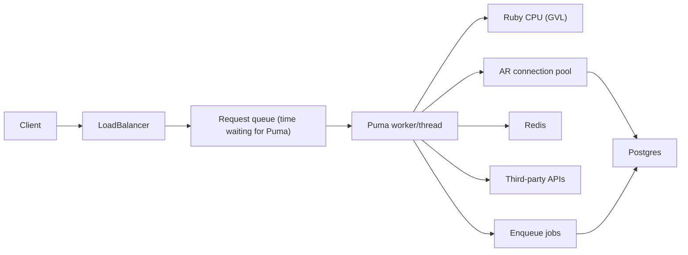

# Scaling Playbook

A repeatable way to answer "traffic doubled overnight and everything is on fire — what do you do?" and to actually do it.

The core loop:

> **Stabilize → Measure → Find the bottleneck → Fix that one thing → Verify → Repeat**

Everything below is detail on one of those steps. Hands-on practice for each failure mode lives in [scaling-labs.md](scaling-labs.md).

---

## 1. Why "raise threads and the DB pool" is a weak answer

It skips *measure* and *find the bottleneck* and jumps straight to a fix that is only right for one specific bottleneck (app servers waiting on I/O with spare DB capacity). For most other causes it is neutral or actively harmful:

| If the real bottleneck is… | Effect of more threads + bigger pool |
|---|---|
| Postgres CPU / slow queries | More concurrent queries on a saturated DB → every query gets slower |
| Postgres `max_connections` | You hit `FATAL: too many connections` sooner and *all* requests fail |
| Ruby CPU (GVL) | Threads take turns on one core; latency gets worse, throughput flat |
| A slow third-party API | Briefly helps, then all new threads also block on the vendor |
| Row-lock contention | More waiters queued on the same lock |
| Memory | More threads → more memory → swapping / OOM kills |

What interviewers want to hear is the *process* — and evidence that you know which signals point to which cause.

---

## 2. The first 15 minutes (triage)

Say this out loud in interviews, roughly in this order.

1. **Confirm and size the impact.** Is it down (5xx, timeouts) or slow (high p95/p99)? All endpoints or some? All customers or one region/tenant? Check the error tracker, APM, and load balancer metrics.
2. **What changed?** Recent deploy, config change, migration, feature flag, cron/batch job, marketing email, a new customer, a bot/scraper, an upstream vendor incident. *"Traffic doubled" is a hypothesis — verify it in LB request counts.* Is it real users or one IP/user-agent?
3. **Stop the bleeding** (mitigate before you diagnose deeply):
   - Roll back a suspicious deploy / flip the feature flag off.
   - Rate limit or block abusive traffic (WAF, Rack::Attack, Rails 8 `rate_limit`).
   - Shed non-critical load: pause batch jobs, disable expensive features (search, recommendations, exports), serve stale cache.
   - Scale out the tier that is *proven* to be the bottleneck (more app instances only helps if the DB has headroom).
4. **Communicate.** Incident channel, status page, one person driving, one person communicating.
5. **Then diagnose** with the golden signals, layer by layer (next sections).
6. **Afterwards:** blameless postmortem, permanent fix, alerting that would have caught it earlier, load test to prove the new capacity.

---

## 3. The four golden signals

| Signal | What to look at | Rails-specific source |
|---|---|---|
| **Latency** | p50, p95, p99 — never just the average. Separate successful vs failed request latency. | APM (Datadog/New Relic/Scout/Skylight), Rails log `Completed 200 in Xms`, `Server-Timing` header |
| **Traffic** | Requests/sec per endpoint, jobs enqueued/sec | LB metrics, APM throughput |
| **Errors** | 5xx rate, timeouts, specific exceptions | Error tracker; look for `ConnectionTimeoutError`, `Rack::Timeout`, `PG::ConnectionBad`, `Net::ReadTimeout` |
| **Saturation** | How "full" each resource is: CPU, memory, Puma busy threads + backlog, DB connections, DB CPU/IO, Redis memory, Sidekiq queue latency | Puma stats, `pg_stat_activity`, Sidekiq Web, host metrics |

**Saturation is the one that finds bottlenecks.** Latency tells you *that* something is wrong; saturation tells you *where*. The bottleneck is the first resource that hits 100%.

---

## 4. Where a Rails request spends its time



Total response time = **queue time** + **Ruby CPU time** + **waiting on I/O** (DB, Redis, HTTP) + **waiting for the GVL** + **waiting for a DB connection**.

The single most useful split:

- **Request queue time is high, but time inside Rails is normal** → not enough capacity at the app tier (or capacity is tied up by slow requests elsewhere). Requests are waiting *in line* for a free Puma thread.
- **Time inside Rails is high** → something in the request got slower. Break it down: DB time? View/serialization (CPU)? External call?

### Puma concurrency model in one paragraph

Puma runs **workers** (forked OS processes, `WEB_CONCURRENCY`) and each worker runs **threads** (`RAILS_MAX_THREADS`). Because of CRuby's **GVL**, only one thread per process executes Ruby at a time; threads only help while other threads are *waiting on I/O* (DB, HTTP, Redis), during which the GVL is released. So:

- I/O-heavy app → threads help (Rails default 3 per process is a latency-friendly compromise).
- CPU-heavy work → threads don't help; you need **more processes** (workers or machines), roughly one per core.
- Rule of thumb: `workers ≈ cores`, `threads ≈ 3–5`, and measure.

### Where to measure each piece

| Piece | Tool |
|---|---|
| Queue time | APM "request queuing" (from `X-Request-Start` set by the LB), Puma `backlog` in stats |
| Ruby vs DB vs view time | Rails log line, `Server-Timing` header, APM traces |
| DB internals | `pg_stat_statements` (top queries by total time), `pg_stat_activity` (what's running/waiting now), `pg_locks`, `EXPLAIN (ANALYZE, BUFFERS)` |
| Puma | `pumactl stats` / control app: `backlog`, `running`, `pool_capacity`, `busy_threads` |
| Sidekiq | Sidekiq Web: queue **latency** (age of oldest job) matters more than size |

---

## 5. Symptom → likely cause cheat sheet

| Symptom | Likely cause | First checks | Typical fixes |
|---|---|---|---|
| High request queue time, low app CPU, low DB load | Puma threads blocked on something slow (external API, `sleep`, slow Redis) | APM traces, which external calls are slow | Timeouts, move to background job, circuit breaker |
| High request queue time, app CPU pegged | CPU-bound Ruby (serialization, bcrypt, big loops) → GVL | Host CPU, APM shows time in Ruby not DB | More processes/instances, optimize hot code, cache rendered output |
| Latency up, DB CPU pegged | Slow/unindexed queries, N+1, missing cache | `pg_stat_statements` sorted by `total_exec_time` | Index, fix N+1, cache, read replica |
| One endpoint fires hundreds of queries | N+1 | Query count per request, logs, Bullet/Prosopite, `strict_loading` | `includes`/`preload`, counter caches |
| `ActiveRecord::ConnectionTimeoutError` | AR pool smaller than concurrency, or slow queries holding connections | Pool vs threads; long transactions | Pool ≥ threads; fix slow queries; shorter transactions |
| `PG::ConnectionBad: too many clients already` | Total connections across all processes > Postgres `max_connections` | Do the connection math (below) | PgBouncer, fewer threads/workers, split sidekiq pool |
| Many queries `waiting` in `pg_stat_activity` with lock waits | Lock contention on hot rows | `pg_locks` / `pg_blocking_pids()` | Atomic updates, smaller transactions, don't do I/O inside transactions, shard/buffer counters |
| Sidekiq queue latency climbing | Jobs slower than arrival rate, starved queues, retry storm | Sidekiq Web latency per queue, retries tab | More/separate workers, queue priorities, fix slow jobs, idempotency + backoff |
| Latency spikes every N seconds | Cache stampede when a hot key expires | Correlate spikes with TTL | `race_condition_ttl`, jittered TTLs, background refresh, locks |
| Memory climbs until restart / OOM kills | Leaks, bloat, too many threads, big object allocations | Container memory, `GC.stat`, allocation profiling | jemalloc, fewer threads, `puma_worker_killer`, stream/paginate |
| p99 bad but p50 fine | A subset: one tenant, one big account, one slow path | Break down latency by endpoint/customer | Fix that path; pagination; per-tenant limits |

---

## 6. Connection math (the part the original answer missed)

Every Puma thread and every Sidekiq thread can hold a Postgres connection. Postgres has a hard limit (`max_connections`, default 100), and each connection is a whole OS process using several MB of RAM — Postgres does *not* get faster with more connections; past a point it gets slower.

```
connections needed =
    (web hosts × puma workers × threads per worker)
  + (sidekiq hosts × sidekiq processes × sidekiq concurrency)
  + consoles, cron, migrations, monitoring
```

Example: 4 web hosts × 4 workers × 5 threads = 80, plus 2 sidekiq hosts × 10 concurrency = 20 → **100 connections**. Postgres default limit: 100. One deploy (old + new processes overlapping) and you're out.

So "double the threads and the pool" turns 100 into 200 → every request fails with `too many clients already`.

The fixes, in order:

1. **Rails pool per process = that process's concurrency.** Web: `max_connections` (Rails 8.1 name for `pool`) = `RAILS_MAX_THREADS`. Sidekiq: = Sidekiq `concurrency`. Bigger is wasteful; smaller causes `ConnectionTimeoutError`.
2. **PgBouncer** (transaction pooling) between Rails and Postgres: thousands of client connections multiplexed onto a small number of real Postgres connections. Caveat: transaction mode breaks session-level features (session advisory locks, `SET`, `LISTEN/NOTIFY`, and historically prepared statements — set `prepared_statements: false` or use PgBouncer ≥ 1.21 with `max_prepared_statements`).
3. **Make queries faster** — a query that takes 10ms instead of 100ms holds a connection 10× less time. This is usually the biggest lever.

Note on Rails 7.2+: Active Record now leases a connection *per query* (via `with_connection`) instead of pinning one for the whole request, unless you call `lease_connection` or are inside a transaction. That reduces pool pressure for requests that spend most of their time outside the DB.

Our lab config: `RAILS_MAX_THREADS` in [backend/config/puma.rb](../backend/config/puma.rb), `max_connections` / `DB_POOL` in [backend/config/database.yml](../backend/config/database.yml), `SIDEKIQ_CONCURRENCY` in [backend/config/sidekiq.yml](../backend/config/sidekiq.yml), Postgres `max_connections` via `PG_MAX_CONNECTIONS` in [compose.lab.yml](../compose.lab.yml).

---

## 7. A model answer to the original question

> "Let's say traffic doubles overnight and everything's blowing up. How do you find out what's going wrong and how do you fix it?"

Roughly 2–3 minutes spoken:

> **First I'd stabilize and confirm.** I'd check our dashboards: is it errors or latency, all endpoints or some? I'd verify the traffic increase is real and legitimate — the load balancer request counts, and whether it's spread across users or concentrated on one IP or endpoint, which might mean a bot or a client retry loop. I'd check what changed: a deploy, a migration, a feature launch, a marketing email. If there's an obvious suspect I'd roll it back or flag it off. If it's abusive traffic I'd rate limit it. And I'd shed non-critical load — pause batch jobs, turn off expensive features — to buy time.
>
> **Then I'd find the bottleneck using saturation metrics, layer by layer.** In APM I'd split response time into request queue time versus time inside the app. If requests are queueing but the app itself is fast, we're out of app capacity — so I'd check app CPU. If CPU is pegged, that's Ruby CPU and the GVL, and we need more processes, not more threads. If CPU is low but threads are all busy, threads are blocked waiting on something — usually the database or a third-party API.
>
> For the database I'd look at DB CPU and connections, then `pg_stat_statements` for the queries consuming the most total time, and `pg_stat_activity` for what's running or waiting on locks right now. Doubling traffic often exposes a query that was fine at 1x — a missing index, an N+1, or a hot row everyone's updating.
>
> **Then fix the specific bottleneck** — and I'd be careful about the knee-jerk fix of adding threads and connections, because if Postgres is the bottleneck that makes it worse, and it's easy to blow through Postgres's connection limit: web hosts × workers × threads plus Sidekiq concurrency. If we need more connections, that's what PgBouncer is for.
>
> Typical fixes depending on what we found: add the index concurrently, fix the N+1 with `includes`, cache the expensive read with `Rails.cache` and stampede protection, add timeouts and a circuit breaker on the slow vendor and move it to a background job, scale out web processes if we're CPU bound and the DB has headroom, add a read replica for read-heavy load.
>
> **Then verify** the metric that was saturated actually came down, and **afterwards** do a postmortem: alerting on saturation so we see it coming, load testing to know our real capacity, and longer-term work like caching, read replicas, or queue isolation.

Notice the shape: **stabilize → measure → hypothesis from signals → targeted fix → verify → prevent.** Specific tool names (`pg_stat_statements`, queue time, GVL, PgBouncer) signal real experience.

---

## 8. What the labs proved (cheat sheet)

Measured in [scaling-labs.md](scaling-labs.md), each at "traffic doubled":

| Lab | Broken | Fixed | One-line lesson |
|---|---|---|---|
| Missing index | p95 1.4s (30s at 4x) | p95 18ms; 4.5ms at 100 req/s | `pg_stat_statements` + `EXPLAIN`; add index `CONCURRENTLY` |
| N+1 | p95 8.5s, 101 queries | p95 11ms, 2 queries | Cost is round trips *and* Ruby CPU; "DB time" inflated by GVL wait |
| Pool < threads | 15.5% `ConnectionTimeoutError` | 0 errors | Pool = threads; too small shows as slowness before errors |
| Too many PG connections | 15.5% `too many clients` | PgBouncer: 0 errors, but slower | PgBouncer protects Postgres; it doesn't add capacity |
| CPU-bound + more threads | p95 4.9s (10 threads no better) | p95 94ms with 2 processes | GVL: CPU work needs processes, not threads |
| Slow vendor | 63% timeouts | p95 15ms async / 415ms breaker | Timeouts + breaker + fallback; threads help only until the vendor slows more |
| No cache / stampede | 66% failed / p99 182ms | p99 12ms | `race_condition_ttl`, jitter, background refresh |
| Sidekiq backlog | critical job waited 21.6s | 214ms | Separate queues by latency; alert on queue latency |
| Hot row lock | p99 6.6s | p99 76ms | No I/O in transactions; atomic updates |

---

## 9. Longer-term architecture levers

Once the fire is out, interviewers often ask "and how would you make sure this doesn't happen again / handle 10x?" Lead with *measure first* (load test to find the next bottleneck), then pick levers that target it. Each has a cost — name it.

### Reduce work per request
| Lever | When | Trade-off |
|---|---|---|
| **HTTP caching / CDN** (`Cache-Control`, `stale-while-revalidate`, `fresh_when`/ETags) | Public or semi-public reads, assets, API responses identical across users | Invalidation; never cache personalized responses at a shared layer |
| **Application caching** (`Rails.cache`, fragment/Russian-doll, low-level) | Expensive reads with tolerable staleness | Stampedes, invalidation bugs, cold-cache cliffs after deploys/Redis restarts |
| **Precomputation** (counter caches, materialized views, rollup tables, denormalization) | Aggregates read far more than written | Write amplification, staleness, backfills |
| **Move work off the request path** (Sidekiq) | Emails, webhooks, third-party calls, exports | Eventual consistency, need for idempotency, queue capacity planning |
| **Pagination / limits** (keyset over `OFFSET`) | Any endpoint whose cost grows with data size | API changes for clients |

### Add capacity
| Lever | When | Trade-off |
|---|---|---|
| **Horizontal app scaling** (more instances/workers) + autoscaling | App CPU or Puma saturation *and DB has headroom* | Multiplies DB connections; autoscale on **request queue time**, not CPU alone |
| **Read replicas** (`connects_to database: { writing: :primary, reading: :replica }`, automatic role switching) | Read-heavy load on the primary | Replication lag → read-your-own-writes bugs (Rails' `delay` setting for role switching after writes) |
| **PgBouncer** | Connection count, not query cost, is the limit | Transaction mode breaks session features (advisory locks, `SET`, `LISTEN`) |
| **Vertical DB scaling** | Fastest relief for a CPU/RAM-bound DB | Cost; there's a ceiling; buys time rather than solving |
| **Separate datastores** (cache Redis vs Sidekiq Redis; dedicated DB for a hot domain) | One workload starving another | More infrastructure to run |
| **Partitioning / archiving** | Huge tables where most rows are cold | Query and migration complexity |
| **Sharding** (Rails horizontal sharding, Citus) | Write volume beyond one primary | Big complexity; usually last resort |

### Protect the system
| Lever | Purpose |
|---|---|
| **Rate limiting** (Rails 8 `rate_limit to: 10, within: 1.minute`, Rack::Attack, WAF/CDN rules) | Stop one client/bot from consuming shared capacity |
| **Timeouts everywhere** (`Rack::Timeout` / LB timeout, `statement_timeout` in Postgres, HTTP client timeouts, Redis timeouts) | Bound how long any one request can hold resources |
| **Circuit breakers + fallbacks** (stoplight, circuitbox, semian) | Fail fast when a dependency is down |
| **Load shedding / feature flags** | Turn off expensive non-critical features under pressure |
| **Queue isolation** | Critical jobs never wait behind bulk jobs |
| **Bulkheads** (separate Puma pools/instances for critical endpoints, e.g. checkout vs search) | One slow endpoint can't consume all threads |

### Know your capacity before it's tested for you
- **Load test** realistic traffic mixes regularly (k6 like here) to find the *next* bottleneck and your headroom ("we can take 3x before the DB saturates").
- **Alert on saturation**, not just errors: request queue time, DB CPU and connections, Sidekiq queue latency, Redis memory.
- **SLOs and error budgets** so "is it slow?" has an objective answer.
- **Capacity planning**: growth rate × headroom → when do we need the next lever?
- **Postmortems** that end with a detection improvement, not just a fix.

### A good "how would you handle 10x?" answer shape (see below)

---

## 10. Mock interview kit

### Rubric (what the interviewer is scoring)
1. **Stabilizes first** — mitigation before deep diagnosis (rollback, flags, rate limit, shed load).
2. **Verifies assumptions** — is traffic really doubled? legitimate? what changed?
3. **Measures before fixing** — names specific signals and tools, not guesses.
4. **Localizes the bottleneck** — queue vs app time, app CPU vs DB CPU, saturation per resource.
5. **Targeted fix with trade-offs** — and knows why "more threads/connections" can hurt.
6. **Verifies and prevents** — confirms the metric moved, postmortem, alerting, load testing.
7. **Concrete experience signals** — specific numbers, tool names, a story.

### Question bank
1. Traffic doubles overnight and everything's blowing up. How do you find out what's wrong and fix it?
2. p50 latency is fine but p99 is 10 seconds. What's going on?
3. You're seeing `ActiveRecord::ConnectionTimeoutError` in production. Walk me through it.
4. Postgres CPU is at 100%. What do you do in the next 10 minutes? The next week?
5. Someone proposes doubling Puma threads to handle more traffic. How do you respond?
6. A third-party payment API starts taking 10 seconds to respond. What happens to your app, and how do you design for it?
7. Your Sidekiq queue has 2 million jobs and password reset emails are 40 minutes late. Now what?
8. Every 5 minutes, latency spikes for a few seconds. Ideas?
9. How would you prepare the app for a 10x launch day in a month?
10. We just added a read replica and users report their edits "disappear" for a moment. Why?
11. A single endpoint gets slower as our biggest customer grows. How do you approach it?
12. How do you size Puma workers and threads for a new service?

### Turning the labs into your story
You may not have had a production incident like this — but you have now reproduced and diagnosed nine of them. It's honest and strong to say: *"I hadn't hit this at scale in production, so I built a lab: I load-tested a Rails app at 2x traffic and reproduced connection exhaustion, N+1s, GVL saturation... Here's what I learned, for example that a too-small pool shows up as slowness before it shows up as errors."* Specific, measured, self-directed.

### A good "how would you handle 10x?" answer shape
> "First I'd load test to find out what breaks first rather than guessing. Typically for a Rails app it's the database. So: make sure the hot queries are indexed and N+1-free, cache the expensive reads, move slow work into background jobs. Then scale out web processes while keeping the connection count under control with PgBouncer, and add read replicas for read-heavy paths. Rate limiting and timeouts protect us in the meantime, and I'd alert on queue time and DB saturation so we see the next limit coming."
